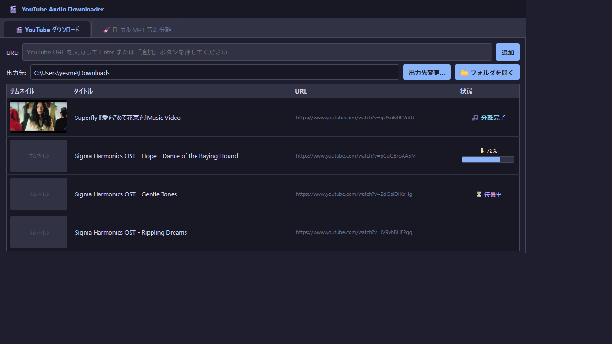
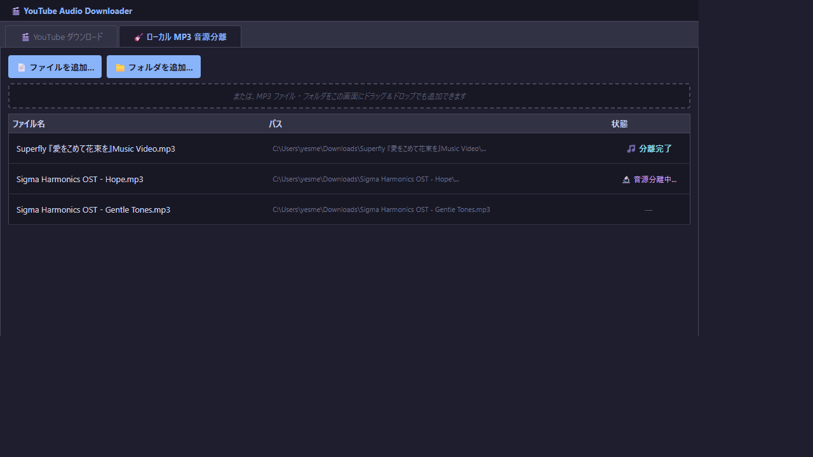
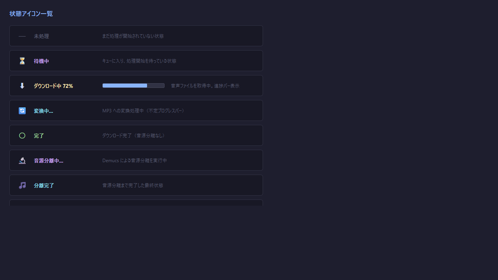
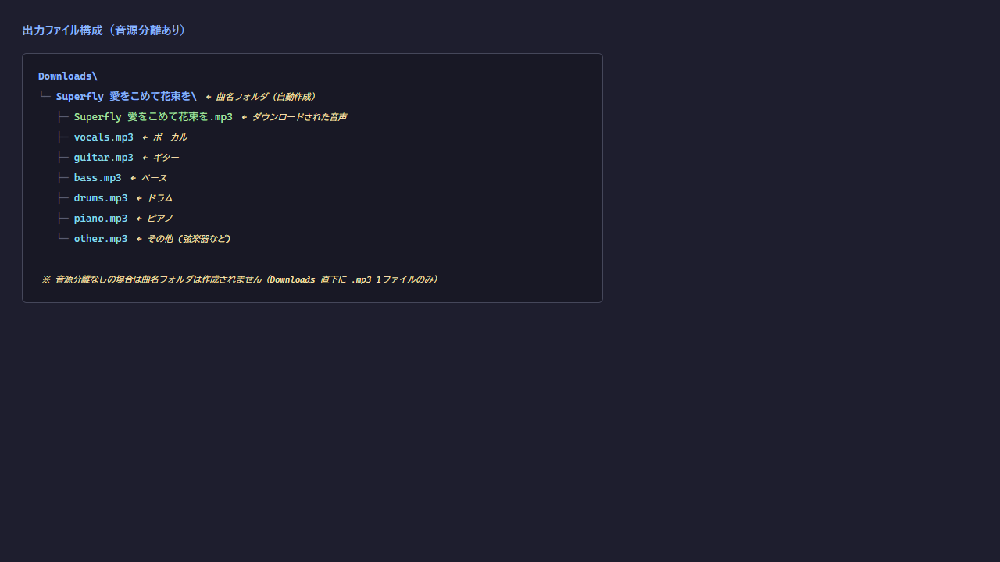

# YouTube Audio Downloader — 使い方マニュアル

**バージョン:** 1.0  
**対応OS:** Windows 10 / 11

---

## 目次

1. [概要](#1-概要)
2. [起動方法](#2-起動方法)
3. [画面構成](#3-画面構成)
4. [YouTube ダウンロードタブ](#4-youtube-ダウンロードタブ)
   - [URL を追加する](#41-url-を追加する)
   - [出力先フォルダを設定する](#42-出力先フォルダを設定する)
   - [音源分離オプションを設定する](#43-音源分離オプションを設定する)
   - [ダウンロードを開始する](#44-ダウンロードを開始する)
   - [右クリックメニュー](#45-右クリックメニュー)
5. [ローカル MP3 音源分離タブ](#5-ローカル-mp3-音源分離タブ)
6. [状態アイコンの見方](#6-状態アイコンの見方)
7. [出力ファイルの構成](#7-出力ファイルの構成)
8. [よくある質問](#8-よくある質問)

---

## 1. 概要

**YouTube Audio Downloader** は、YouTube の動画から音声を MP3 ファイルとして保存し、さらに AI（Demucs）を使って楽器ごとのトラックに音源分離できるツールです。

**主な機能:**

| 機能 | 説明 |
|------|------|
| YouTube MP3 ダウンロード | URL を貼り付けるだけで高品質 MP3 (192kbps) を保存 |
| YouTube MP4 ダウンロード | 映像付きの MP4 ファイルとしても保存可能 |
| AI 音源分離 | Vocal / Guitar / Bass / Drums / Piano / Other に分離 |
| ローカルファイル対応 | 手持ちの MP3 ファイルに対しても音源分離を実行 |
| 並列処理 | 最大 10 ファイルを同時にダウンロード・処理 |
| リスト自動保存 | ダウンロードリストは `download_list.json` に自動保存 |

---

## 2. 起動方法

### EXE ファイルで起動する場合

1. `youtube_dl.exe` をダブルクリックします。
2. 初回起動時は Windows Defender のポップアップが表示される場合があります。「詳細情報」→「実行」をクリックしてください。

### Python スクリプトで起動する場合

```powershell
# 仮想環境をアクティベート（任意）
cd youtube_dl
python app.py
```

> **依存ライブラリ:**  `pip install PySide6 yt-dlp demucs pydub Pillow`  
> ffmpeg が PATH に含まれているか、EXE 版では `ffmpeg.exe` が同梱されている必要があります。

---

## 3. 画面構成



アプリは **2 つのタブ** で構成されています。

| タブ | 用途 |
|------|------|
| 🎬 YouTube ダウンロード | YouTube URL からダウンロード＆音源分離 |
| 🎸 ローカル MP3 音源分離 | 手持ちの音声ファイルを音源分離のみ実行 |

---

## 4. YouTube ダウンロードタブ

### 4.1 URL を追加する

1. 上部の **URL 入力欄**に YouTube の URL を貼り付けます。
2. `Enter` キーを押すか、**「追加」** ボタンをクリックします。
3. 自動的にタイトルとサムネイルが取得され、テーブルに追加されます。

> **ポイント:** プレイリストの URL でも追加できますが、**1 曲ずつ個別の URL** で追加することを推奨します（プレイリスト全体の一括取得は非対応）。

---

### 4.2 出力先フォルダを設定する

- **「出力先変更...」** ボタン → フォルダ選択ダイアログが開きます。
- **「📁 フォルダを開く」** ボタン → 現在の出力先フォルダをエクスプローラーで開きます。

---

### 4.3 音源分離オプションを設定する


テーブル下部の **「音源分離 — 抽出するパートを選択」** グループで設定します。

| チェックボックス | 抽出されるトラック |
|----------|------------|
| Vocal | ボーカル・歌声 |
| Guitar | ギター |
| Bass | ベース |
| Drums | ドラム |
| Piano | ピアノ |
| その他 | 上記以外（弦楽器・シンセ等） |
| **動画をダウンロード (MP4)** | MP3 ではなく映像付き MP4 でダウンロード |

> **何も選択しない場合:** 音源分離は行われず、MP3 のみ保存されます。  
> **チェックを入れた場合:** ダウンロード完了後に自動で音源分離が実行されます。

**並列数** スピンボックス（右端）で、同時に処理するファイル数を `1〜10` の範囲で変更できます。  
PCのスペックが低い場合は `1〜2` に下げることを推奨します。

---

### 4.4 ダウンロードを開始する

1. **「▶ スタート」** ボタンをクリックします。
2. ダウンロード済みでないすべての URL が処理キューに入ります。
3. ボタンが **「ダウンロード中... (完了数 / 合計)」** に変わり、処理状況が確認できます。

---

### 4.5 右クリックメニュー


テーブルの行を **右クリック** するとメニューが表示されます。

| メニュー項目 | 動作 |
|-------------|------|
| 🔄 再ダウンロード | 選択行のダウンロードをやり直す |
| 🗑 選択行を削除 | リストから選択行を削除する |

> **複数行選択:** `Ctrl + クリック` で複数行を選択してから右クリックすると、まとめて操作できます。

---

## 5. ローカル MP3 音源分離タブ



手持ちの音声ファイルを音源分離したい場合に使用します。

### ファイル・フォルダを追加する方法

| 方法 | 操作 |
|------|------|
| ファイル選択ダイアログ | **「📄 ファイルを追加...」** ボタン |
| フォルダ一括追加 | **「📁 フォルダを追加...」** ボタン（サブフォルダも再帰的に検索） |
| ドラッグ＆ドロップ | MP3 ファイルやフォルダを画面にドロップ |

**対応フォーマット:** `.mp3` `.wav` `.flac` `.ogg` `.m4a` `.aac` `.opus` `.wma`

### 分離スタートの手順

1. 抽出したいパートにチェックを入れます（デフォルト：全選択）。
2. 出力先フォルダを確認・変更します。
3. **「▶ 分離スタート」** ボタンをクリックします。

> **初回実行時:** AI モデル（htdemucs_6s、約 400MB）を自動ダウンロードします。  
> 2 回目以降はキャッシュが使用されるため高速に開始されます。

---

## 6. 状態アイコンの見方



テーブルの**「状態」列**に処理の進捗が表示されます。

| アイコン | 意味 |
|---------|------|
| `—` | 未処理（キューに入っていない） |
| ⏳ 待機中 | キューに入り、処理開始を待っている |
| ⬇ XX% | ダウンロード中（プログレスバー付き） |
| 🔄 変換中... | MP3 への変換処理中 |
| ○ 完了 | ダウンロード完了（音源分離なし） |
| 🔬 音源分離中... | Demucs による音源分離を実行中 |
| 🎵 分離完了 | 全処理が完了した最終状態 |
| ✕ エラー | エラー発生。**クリックすると詳細が表示されます** |

---

## 7. 出力ファイルの構成



### 音源分離あり（パートにチェック済み）

```
Downloads\
└─ 曲名\                         ← 曲名のサブフォルダが自動作成
   ├─ 曲名.mp3                   ← ダウンロードされた音声
   ├─ vocals.mp3                 ← ボーカル
   ├─ guitar.mp3                 ← ギター
   ├─ bass.mp3                   ← ベース
   ├─ drums.mp3                  ← ドラム
   ├─ piano.mp3                  ← ピアノ
   └─ other.mp3                  ← その他
```

### 音源分離なし（パート未選択）

```
Downloads\
└─ 曲名.mp3                      ← サブフォルダなし、直下に保存
```

### MP4 ダウンロードあり

```
Downloads\
└─ 曲名\
   ├─ 曲名.mp4                   ← 映像付き動画
   └─ 曲名.mp3                   ← 映像から抽出した音声
```

---

## 8. よくある質問

**Q. ダウンロードが「エラー」になる**  
A. YouTube 側のレート制限や動画の地域制限が原因の場合があります。しばらく待ってから「🔄 再ダウンロード」で再試行してください。

**Q. 音源分離が非常に遅い**  
A. 初回は AI モデルのダウンロード（約 400MB）が必要です。また、GPU がない PC では CPU 処理となるため 1 曲あたり数分〜十数分かかる場合があります。「並列数」を `1` に下げると安定して処理できます。

**Q. リストを閉じたら消えてしまった**  
A. ダウンロードリストは `download_list.json` に自動保存されます。アプリを再起動すると復元されます。

**Q. どのフォルダにモデルがキャッシュされる？**  
A. EXE 版は `<EXE と同じフォルダ>\models\` に保存されます。開発版は `youtube_dl\models\` に保存されます。

**Q. プレイリスト全体をまとめてダウンロードしたい**  
A. 現バージョンではプレイリスト URL を追加した場合、先頭の 1 曲のみ取得されます。プレイリスト内の URL を個別に追加してください。
